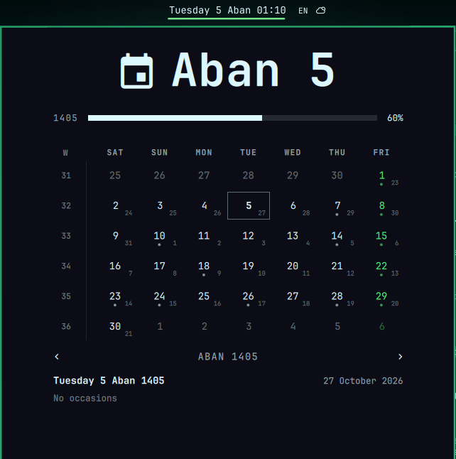

# Jalali Calendar for Omarchy

The Omarchy clock, on the Persian calendar.

It is the stock `omarchy.clock` with the Jalali calendar underneath: the same
label, the same popup, the same clicks and keys, the same settings. On top of
that, it knows Iran's official holidays and occasions, lunar ones included,
straight from the official calendar.



- **Bar label** in Jalali: `Tuesday 5 Aban 14:30`. Right-click walks the
  formats, middle-click picks a timezone, left-click opens the calendar.
- **Month grid** starting on Saturday, with the Gregorian date tucked into
  each day, week-of-year numbers, and Fridays and official holidays in the
  theme's urgent color.
- **Occasions** for every day: national (Nowruz, Yalda, Mehregan, ...),
  religious (Eid al-Fitr, Ashura, ...), and international. Days with an
  occasion carry a dot; point at one to read it.
- **Year progress** from Nowruz to Esfand, and the memento mori rail,
  with your Jalali birth year.
- **English by default**, with the Jalali month names as printed on bilingual
  Iranian calendars. Persian, right to left with Persian digits, is one
  setting away.

Everything ships with the plugin. No network, no services, no dependencies.

## Install

```bash
omarchy plugin add https://github.com/AryanHamedani/omarchy-jalali-calendar --enable
```

To take the stock clock's place, put it where the clock was and remove the
clock from the bar:

```bash
omarchy bar move io.github.aryanhamedani.jalali-calendar --section center --after omarchy.clock
```

Then delete the `omarchy.clock` entry from `bar.layout` in
`~/.config/omarchy/shell.json`, and point `bar.centerAnchor` at
`io.github.aryanhamedani.jalali-calendar` if it named the clock.

## Use

| Action                 | Does                                          |
|------------------------|-----------------------------------------------|
| Left click             | Open the calendar                             |
| Right click            | Next label format                             |
| Middle click           | Pick a timezone                               |
| `←` `→` / `[` `]`      | Previous / next month                         |
| `↑` `↓` / `{` `}`      | Previous / next year                          |
| `T` or `Enter`         | Back to today                                 |
| `W`                    | Start weeks on Monday / Saturday              |
| Scroll                 | Step months                                   |
| Double-click year bar  | Set your birth year for the life rail         |

From the command line, or a keybinding:

```bash
omarchy shell io.github.aryanhamedani.jalali-calendar toggle
```

`open`, `close`, `refresh`, `cycleFormat`, and `toggleWeekStart` work too.

## Configure

Settings live on the widget's entry in `~/.config/omarchy/shell.json`:

```json
{
  "id": "io.github.aryanhamedani.jalali-calendar",
  "format": "dddd d MMMM HH:mm",
  "language": "en"
}
```

| Setting             | Default             | Meaning                                  |
|---------------------|---------------------|------------------------------------------|
| `format`            | `dddd HH:mm`        | Bar label                                |
| `formatAlt`         | `d MMMM yyyy`       | Extra format in the right-click ring     |
| `verticalFormat`    | `HH\n—\nmm`         | Label on a vertical bar                  |
| `language`          | `en`                | `en`, or `fa` for Persian, right to left |
| `fontFamily`        | `Vazirmatn`         | Face for Persian text, when `fa`         |
| `weekStartDay`      | `saturday`          | First column of the grid                 |
| `birthYear`         |                     | Jalali year, for the life rail           |
| `lifeExpectancy`    | `90`                | Years the life rail measures against     |

Formats read like Qt's, but name the Jalali date:

| Token            | Means                     | Example     |
|------------------|---------------------------|-------------|
| `d` `dd`         | Day of month              | `5` `05`    |
| `dddd`           | Weekday                   | `Tuesday`   |
| `M` `MM`         | Month number              | `8` `08`    |
| `MMMM`           | Month name                | `Aban`      |
| `yy` `yyyy`      | Year                      | `05` `1405` |
| `H` `HH` `h` `hh`| Hour, 24 or 12            | `14` `2`    |
| `mm`             | Minute                    | `30`        |
| `ss`             | Second, ticks only if shown | `09`      |
| `AP`             | AM / PM                   | `PM`        |
| `'text'`         | Literal text              |             |

Persian mode wants a font with Persian script. Vazirmatn is the default;
install it with `omarchy pkg aur add vazirmatn-fonts`, or name any other face in
`fontFamily`.

## Holidays and occasions

Solar dates never move, but lunar ones are fixed each year by moon sighting,
so no formula reproduces the official calendar. This plugin does not guess.
It ships time.ir's official list for each year, and a year without its file
still shows every solar occasion and holiday, and simply leaves the lunar ones
out.

The bundled years are 1404, 1405, and 1406. Add more with:

```bash
bin/fetch-events 1407
```

The data comes from:

- **time.ir**, by way of [holidayapi.ir](https://holidayapi.ir): the official
  holiday roster and the lunar occasions, per year (`events/<year>.json`).
- **[Iran-calendar-events](https://github.com/5adra/Iran-calendar-events)**
  (MIT): the national and international occasions (`events/national.json`,
  `events/international.json`). Its license is in `events/LICENSE.5adra`.
- English titles for all of them are in `events/en.json`.

## Test

```bash
node test/model-test.js
```

The suite converts every day from 1300 to 1500 and checks each one against
ICU's Persian calendar, so the arithmetic is proven against an independent
implementation, not against itself.

## Remove

```bash
omarchy plugin remove io.github.aryanhamedani.jalali-calendar --yes
```

Put `omarchy.clock` back into `bar.layout` if you took it out.

## License

MIT. The Jalali conversion follows the break-table algorithm of
[jalaali-js](https://github.com/jalaali/jalaali-js) (MIT). The widget is built
on Omarchy's own clock (MIT).
